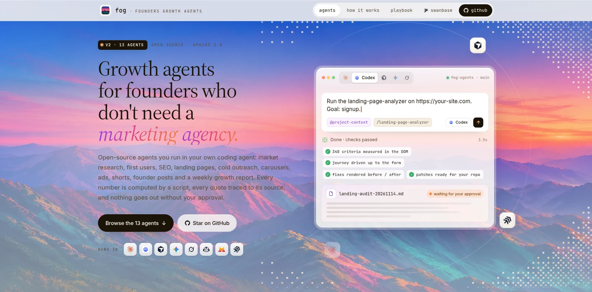

<div align="center">

# fog · Founders Growth agents

**Growth agents for founders who don't need a marketing agency. Open source, and they run in your own coding agent.**

Market research, first users, SEO, landing pages, cold outreach, carousels, ads, shorts, founder posts and a weekly growth report.<br>
Every number is computed by a script, every quote traced to its source, and nothing goes out without your approval.

[Quick start](#quick-start) · [The 13 agents](#the-13-agents) · [Why fog](#why-fog) · [How it works](#how-it-works) · [Build your own](#build-your-own) · [swanbase](#built-by-swanbase)

<br>

<a href="#run-an-agent"></a>
<a href="#run-an-agent"></a>
<a href="#run-an-agent"></a>
<a href="#run-an-agent"></a>
<a href="#run-an-agent"></a>
<a href="#run-an-agent"></a>
<a href="#run-an-agent"></a>
<a href="#run-an-agent"></a>

<sub>Plain markdown workflows and Python scripts: any coding agent that reads files and runs a shell can drive them. No lock-in, no paid API required.</sub>

<br><br>

<table><tr><td>
<b>Built by <a href="https://swanbase.co/en/?utm_source=github&utm_medium=readme&utm_campaign=fog-agents">swanbase</a></b>, the growth marketing accelerator for ambitious European startups.<br>
Launch your product fast, find your first 10 to 1,000 customers, raise funds: weekly talks and workshops, unlimited office hours and a dedicated Head of Growth. €0, no fees, all year round.<br>
<a href="https://swanbase.co/en/?utm_source=github&utm_medium=readme&utm_campaign=fog-agents"><b>Discover swanbase →</b></a>
</td></tr></table>

<br>



</div>

## Quick start

```bash
git clone https://github.com/tns-research/fog-agents.git
cd fog-agents
```

Open the folder in your coding agent and ask:

```
Run the project-context agent for https://your-site.com
```

It captures your brand and your business once, into a folder every other agent reuses. Then pick the agent for the job at hand, for example:

```
Run the market-signal agent. Market: freelance invoicing tools for designers.
```

No API key is needed to start: each agent uses what you already have (your coding agent's web search and fetch, local programs, your exports) and tells you up front which tools it will use.

## Why fog

Early-stage founders build well and sell late. Marketing gets pushed to "after launch", and the agency costs more than the runway allows. Generic AI prompts then produce confident copy with invented customers, made-up stats and quotes nobody said.

fog takes the opposite route, one focused agent per growth job, each one checked by code:

- **Proof, or it stays out.** Customer names, metrics and testimonials come from your own proof list or a source URL. A shared claims gate and a writing gate block the rest before you see a draft.
- **Scripts do the counting.** Mention counts, growth figures, word limits, layout measurements and quote matching run in Python, and the report can only cite numbers the scripts produced.
- **You stay in control.** Agents prepare; you send, publish, spend and approve. Publishing needs an approval typed by a person, and every paid call sits behind an explicit confirmation.
- **Your stack, your tools.** Bring your API keys if you have them, or run on free fallbacks. Deliverables land in your project folder as plain files.
- **It learns your taste.** Every run is logged, and every draft you reject becomes a rule the next run follows.

## The 13 agents

One agent per growth job. Run them one at a time, or let `growth-sprint` chain them toward a monthly goal.

### Set up once

| Agent | When to use |
|-------|-------------|
| [`project-context`](./agents/project-context/) | Run this first, once. Capture your brand (colors, fonts, logo, real site assets) and business context (what you sell, ICP, offer, voice) into a shared folder every other agent reuses. No more re-typing the same info per agent. Proof items carry their source, date and consent, people and partner logos live in registries with consent per use, and your deck or notes prefill the context. |

### Find demand and your first users

| Agent | When to use |
|-------|-------------|
| [`market-signal`](./agents/market-signal/) | Before writing copy or code, and on a schedule to watch the market. A stored corpus from HN, Reddit, Stack Exchange, forums and app stores, counts computed by script, every quote checked word for word against its source. |
| [`first-users-hunter`](./agents/first-users-hunter/) | After validation, when you need ten real conversations this week. One row per person who asked for what you build, with the dated signal, proof they post now and a first message written for them. |
| [`cold-outreach-builder`](./agents/cold-outreach-builder/) | When you need 50 to 200 first conversations. One sourced dossier per prospect, sequence linted to zero BLOCK, state and replies tracked between runs. |

### Get found and convert

| Agent | When to use |
|-------|-------------|
| [`seo-audit`](./agents/seo-audit/) | Monthly or when traffic dips. Crawl of the served HTML first, Search Console bands, SERP, a GEO panel on answer engines, refresh briefs, then the published page checked and followed at 14, 28 and 56 days. E-E-A-T signals measured by script, internal linking measured on the links inside the text with the links to add on words your pages already wrote, and with your site repo, a patch per file. A topic registry blocks duplicates and proposes new subjects; write mode drafts the article with its visuals in your brand and its JSON-LD, delivered as a file or a patch. |
| [`landing-page-analyzer`](./agents/landing-page-analyzer/) | Before paying for traffic or after a launch. CRO audit on a 340-criterion grid, measured in the DOM, a journey driven up to the form (never submitted), every finding tied to its evidence, fixes rendered before and after, then turned into patches for your repo. |

### Create content in your brand

| Agent | When to use |
|-------|-------------|
| [`carousel-builder`](./agents/carousel-builder/) | When you need a LinkedIn / Instagram carousel that teaches with sourced material. Six art directions, measured and reviewed slides, PDF, JPEG and MP4. HTML/CSS + Playwright, no paid API. |
| [`static-ads-builder`](./agents/static-ads-builder/) | When you need static Meta / Instagram ad creatives. Funnel-aware concepts rendered locally in HTML/CSS with exact copy in 1:1, 4:5 and 9:16, proofread word by word, read against last period's results. Image models only for photo backgrounds or to restyle your own phone photo (face and hands kept), behind two budget gates. Your best ad becomes a recipe for 5 one-variable tests. |
| [`short-video-builder`](./agents/short-video-builder/) | When you have a landscape talk, pitch or interview. 9:16 shorts with local transcription, verbatim hooks, a full proofread before render, calm face tracking, word-by-word captions, source fps kept, no intro card. |
| [`founder-content-writer`](./agents/founder-content-writer/) | When you have notes, a voice note, a call or a past talk and need LinkedIn and X posts in your voice. Every post traces to a passage of your material, numbers are checked against your proof list, and it hands `posts.json` to `content-publisher`. It never publishes. |

### Publish, measure, plan

| Agent | When to use |
|-------|-------------|
| [`content-publisher`](./agents/content-publisher/) | When a deliverable is ready to post. One variant per network (LinkedIn, X, Instagram, optional Threads and Bluesky), limits and link placement checked by script, a queue only a person can approve, dry-run by default or Zernio, command and webhook adapters. |
| [`growth-pulse`](./agents/growth-pulse/) | Once a week, when you run it or schedule it ([`shared/scheduling.md`](./shared/scheduling.md)), before planning the sprint. Plausible, Umami, GA4, Search Console, social stats (Zernio API, or CSV exports as the fallback) and revenue computed by script, a report whose every number is checked, correlations never sold as causes, and three AARRR experiments for the next sprint. |
| [`growth-sprint`](./agents/growth-sprint/) | When you have a goal for the month. One plan, one approval, then the model chains the other agents inside your open session, checks every result on disk and only comes back for what a person must decide. It prepares the work; you send and count. The budget is the cap on optional paid APIs from your own accounts, 0 by default. |

Plus [`_template-agent`](./agents/_template-agent/), the canonical scaffold every agent in the stack follows. Fork it to build your own.

---

## How the agents connect

Agents never call each other. They read each other's files from your project folder, and every link is optional: if the file is there, the agent uses it and tells you; if not, it runs standalone.

```
project-context        run once; every agent reads it at Step 0 to prefill inputs
      |                and to enforce your claims policy (no invented proof)
      v
market-signal ------ market-signal-<date>.json ------> cold-outreach-builder
      (personas, verbatim quotes + source URLs,        static-ads-builder
       pains, objections)                              carousel-builder
                                                       landing-page-analyzer
                                                       (copy reuses customers' real words)

market-signal ------ market-signal-<date>.json ------> first-users-hunter, founder-content-writer
                                                       (quote authors as signals; verified quotes)

first-users-hunter -- prospects-<date>.csv ----------> cold-outreach-builder
                      + handoff-<date>/dossiers/        -> sequence markdown + generic CSV export
                                                          for any sequencer or mail merge

seo-audit              standalone (GSC + live SERP)

founder-content-writer posts.json -------------------> content-publisher
carousel-builder ----- <label>-<date>/captions.md ---> content-publisher
static-ads-builder                                     (queue, one variant per network,
short-video-builder -- export/<id>.mp4 --------------> a person approves every item)

growth-pulse --------- experiments-<date>.json ------> growth-sprint
                                                       (one goal, one approval, then the
                                                        agents above chained by their files)
```

File paths, the sidecar JSON schema and the prospect CSV columns: [`shared/handoffs.md`](./shared/handoffs.md).

---

## How it works

The model writes a spec, a script builds the deliverable, a loop checks the result.

- **Prompts**: each agent ships an `AGENT_<NAME>.md` with a precise workflow (inputs, steps, output skeleton, failure modes).
- **Scripts that check the model**: counts, quotes, renders, links and copy go through scripts before you see them. Rendered images are reviewed and fixed at the source, a fresh reviewer scores the result, and the shared writing gate blocks invented numbers. Every agent runs its tests offline, with no API key.
- **Memory**: each run is logged, and every draft you reject becomes a rule the next run follows.
- **Structure**: every agent has the same folder layout, so your harness sees the same shape regardless of which one you run.
- **Your tools, not ours**: no paid API is required. Agents ask for capabilities (search the web, scrape a page, take a screenshot, generate an image) and use whatever you already have: an API key, a local program, your harness's built-in web search and fetch, or a paste from you. Missing tools degrade the run and show up in the report's Limitations; they never block it. Catalog: [`shared/tools.md`](./shared/tools.md).

---

## Install

### 1. Clone the stack

```bash
git clone https://github.com/tns-research/fog-agents.git
```

### 2. Tell the stack which tools you use (optional)

Every agent runs with zero API keys: it falls back to local programs, your harness's built-in web search and fetch, or asks you to paste an input. To use the tools you already pay for, copy [`shared/tools.example.json`](./shared/tools.example.json) to `<your-projects-root>/<project>/project-context/tools.json` and set each capability to a provider, `builtin`, `manual` or `none`. `project-context` offers to write it for you on its first run. Each agent announces its tool plan at the start of a run.

| Capability | Examples of providers ([full list](./shared/tools.md)) |
|------------|---------------------------------------------------------|
| `web_search` | Exa, Serper, Brave, Tavily, built-in search |
| `scrape` | Firecrawl, Jina Reader, curl, built-in fetch |
| `serp` | Serper, SerpApi, DataForSEO |
| `screenshot`, `page_speed` | Playwright, PageSpeed Insights, Lighthouse (all free) |
| `image_gen` | fal, OpenAI, Gemini, or your own tool (Midjourney, Canva) from the prompts the agent writes |
| `email_finder` | Hunter, Dropcontact, Apollo, or your own enrichment |

### 3. Optional: the default API toolbelt

If you want the providers the stack was built with, build the CLIs listed in [`the20100/cli-skills`](https://github.com/the20100/cli-skills) (it needs Go) and set the keys you have:

```bash
mkdir -p ~/.local/bin
for t in exa firecrawl perplexity; do
  git clone --depth 1 https://github.com/the20100/$t-cli /tmp/$t-cli
  (cd /tmp/$t-cli && go build -o ~/.local/bin/$t .)
  rm -rf /tmp/$t-cli
done
export PATH="$HOME/.local/bin:$PATH"

export EXA_API_KEY="..."          # https://dashboard.exa.ai/api-keys
export FIRECRAWL_API_KEY="..."    # https://www.firecrawl.dev/app/api-keys
export PERPLEXITY_API_KEY="..."   # https://www.perplexity.ai/settings/api
```

---

## Run an agent

Each agent is a self-contained workflow in `agents/<agent-name>/AGENT_<NAME>.md`. Open the repo in your coding agent and ask in plain language: the root [`AGENTS.md`](./AGENTS.md) briefs it on the conventions, and the workflow tells it which skill to load at each step and which script to run.

```
Run the market-signal agent at agents/market-signal/AGENT_MARKET_SIGNAL.md.
Market: freelance invoicing tools for designers. Language: en.
```

| Coding agent | How it picks up the stack |
|--------------|---------------------------|
| Claude Code | Reads `AGENTS.md` when asked and the workflow file, then loads each `SKILL.md` under the agent's `skills/` folder as the step comes. |
| Codex, Cursor, GitHub Copilot, Amp | Read `AGENTS.md` at the repo root on their own; point them at the workflow file and give the inputs. |
| Gemini CLI, Grok, Mistral Vibe | Open the workflow file in the session (or add `AGENTS.md` as context), then give the inputs. |
| Any other harness | Paste the contents of `AGENT_<NAME>.md` as your first message, then answer the inputs it asks for. The file lists every input, output location and failure mode. |

The agent needs to read files and run shell commands (Python scripts, and Playwright or ffmpeg for the rendering agents). Everything it writes goes to your project folder, outside this repo.

---

## Project conventions

### Output location

Every agent writes its deliverable outside its own folder, in your project structure:

```
<your-projects-root>/<project-slug>/<agent-name>/<label>-<YYYYMMDD>.md
```

Example:
```
~/work/acme/market-signal/market-signal-20260427.md
```

### Per-project config

Persistent parameters (brand, market, ICP, target queries) live in:

```
<your-projects-root>/<project-slug>/<agent-name>/config.json
```

The agent creates this file on first run from its `config.example.json`.

---

## Repo layout

```
fog-agents/
├── README.md                       (this file)
├── AGENTS.md                       (briefing for any AI-aware harness)
├── LICENSE
├── NOTICE
├── SECURITY.md                     (how to report a vulnerability, known limits)
├── .github/workflows/validate.yml  (CI: runs scripts/validate_stack.py)
├── scripts/
│   ├── validate_stack.py           (repo consistency checks)
│   └── golden_runs.py              (every agent's offline suite, run with no API key)
├── shared/                         (used by 3+ agents: 8 skills, JSON schemas, scripts, tools catalog, handoffs, scheduling)
│   ├── skills/                     (project context, project memory, tools, writing gate, claims, untrusted content, render review, fresh eyes)
│   ├── schemas/                    (brand, run record, copy rules, people, partners)
│   ├── scripts/                    (validate_json.py, proof.py, registry.py, fetch_fonts.py)
│   ├── tools.md, tools.example.json
│   ├── handoffs.md
│   └── scheduling.md
└── agents/
    ├── _template-agent/            (canonical scaffold)
    ├── project-context/            (run-once: shared brand + business context)
    ├── market-signal/
    ├── first-users-hunter/
    ├── seo-audit/
    ├── landing-page-analyzer/
    ├── cold-outreach-builder/
    ├── carousel-builder/
    ├── static-ads-builder/
    ├── short-video-builder/
    ├── founder-content-writer/
    ├── content-publisher/
    ├── growth-pulse/
    └── growth-sprint/
```

The companion **site** for this stack ships at [fog-agents.com](https://fog-agents.com).

---

## Build your own

Fork [`agents/_template-agent/`](./agents/_template-agent/). Read its `AGENT_TEMPLATE.md`. Fill in the workflow, the inputs, the output template. The structure is the contract. Stick to it.

Hard rules:
- ❌ No vendor-specific tool calls (no `mcp__*`, no `claude-*`, no harness-coupled APIs).
- ❌ No absolute paths to a single user's machine.
- ✅ Use POSIX paths from the user's chosen project root.
- ✅ Ask for capabilities from [`shared/tools.md`](./shared/tools.md), never require an API: every step has a free fallback.
- ✅ Work the same in Claude Code, Cursor, Codex CLI, Gemini CLI.

### Validate before you open a PR

```bash
python3 scripts/validate_stack.py
```

Standard library only, no install. It checks that every relative link and referenced repo path in the markdown resolves, that each agent folder has the template files with valid `AGENT_*.md` / `SKILL.md` frontmatter (`name`, `description`), that every `config.example.json` is valid JSON with a `_comment`, that every `AGENT_*.md` has a `## Tools` section linking the shared resolving-tools skill, that no em or en dash slipped into `.md`, `.json` or `.py` files, that no file states an equity percentage, and that no example or test fixture holds a real-looking e-mail address or LinkedIn profile URL (sample data uses `example.com` addresses and slugs marked `fictive` or `example`). Pass `--private-terms <file>` (one term per line) to also block names or handles you never want published. It exits non-zero with a per-file report on any failure. GitHub Actions runs it on every push and pull request (`.github/workflows/validate.yml`).

---

## Built by swanbase

<a href="https://swanbase.co/en/?utm_source=github&utm_medium=readme&utm_campaign=fog-agents-footer"><b>swanbase</b></a> is the growth marketing accelerator for ambitious European startups, built for strong builders whose product works and who now need customers. fog packs the methods we teach into agents you can run tonight; the program is where you learn to use them, next to people who have already done it.

- **Talks every Tuesday**: CEOs, CMOs and founders share what worked for them on acquisition, conversion and retention.
- **Workshops every Saturday**: small groups, 3 hours, concrete actions on Meta, Google and TikTok ads, cold email, LinkedIn prospecting, SEO, landing pages and CRO.
- **Unlimited office hours every Monday and Friday**: 1-on-1 with the partners on your own problems, plus group sessions with your cohort.
- **A dedicated Head of Growth** you can message any day for your action plan, your campaigns and your results.
- **Resources from day one**: private Discord, 900+ early-stage investors, 50+ growth marketing resources and 20+ recorded talks.

€0, no fees before or after, no subscription. We stay with you from your first 10 customers to your first 1,000, and after that until the exit. 3,000+ hours of mentoring since 2018.

<a href="https://swanbase.co/en/?utm_source=github&utm_medium=readme&utm_campaign=fog-agents-footer"><b>Discover swanbase →</b></a>

## Security

Report vulnerabilities privately through GitHub Security Advisories, never in a public issue. Scope, response and the known limits of the approval and spend gates are in [SECURITY.md](./SECURITY.md).

## License

Apache 2.0, see [LICENSE](./LICENSE) and [NOTICE](./NOTICE).
