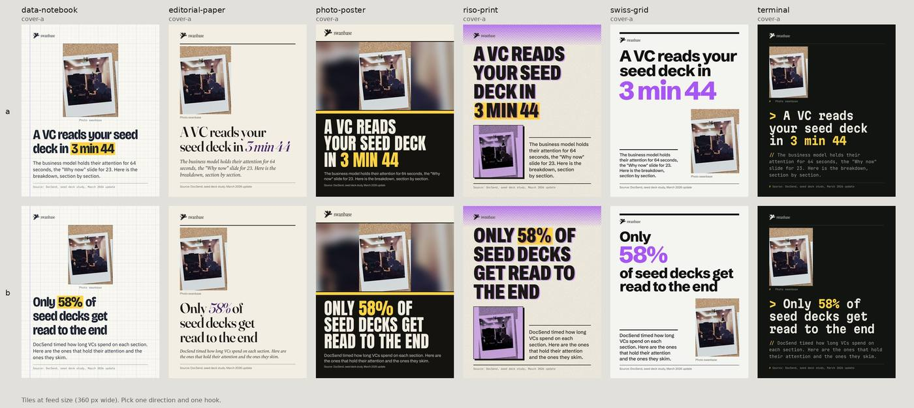
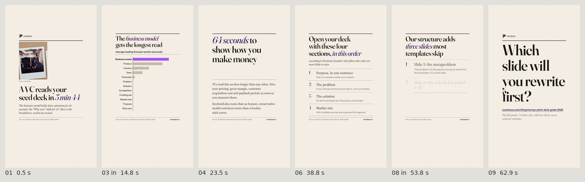

# carousel-builder

A LinkedIn and Instagram carousel at design-studio level, from a topic typed in chat. The agent researches before it writes, keeps every number sourced down to the slide footer, lets you pick the look on a rendered cover board, then builds, measures and reviews its own slides until they are clean. HTML/CSS/SVG rendered by a local Chromium: no Canva, no paid API, no image generation required.



## How it works

1. **Research** (`research.md`): facts with URLs, numbers usable in a chart, objects of the subject, your photos and screenshots.
2. **Angles**: 3 to 5, built on the research, with two cover hooks each.
3. **Spec** (`deck.json`): slides as typed blocks (title, body, list, stat, chart, photo, screenshot, quote, logo row, visual, CTA), every number with its source, captions included. The model never writes HTML.
4. **Stop 1, on image**: the cover rendered in three or six art directions with two hooks, at the size a phone shows it. You pick one direction and one hook.
5. **Build and review**: `build.py` makes the HTML, `fit.js` sizes every text in the browser, `render.py` exports exact PNGs, Instagram JPEGs and a vector PDF, `qa.py` measures overflow, safe zones, text size at feed scale, contrast per text node, collisions, dead space and the tells of a generated deck. The model then reads every slide, fixes the spec, three rounds at most, and a fresh reviewer critiques the deck once.
6. **Stop 2**: PDF, JPEGs, captions with alt text and sources, contact sheet, report. You publish.
7. **Video, optional**: the same slides as a short MP4 (see below).

Two human stops, both on images.

## Art directions

| Direction | Look |
|-----------|------|
| `editorial-paper` | Warm paper, editorial serif, hairline rules |
| `riso-print` | Spot inks on paper, halftone, misregistration |
| `swiss-grid` | Strict grid, grotesque, oversized numerals |
| `photo-poster` | Your photo shown whole, solid type band |
| `data-notebook` | Graph paper, the chart as the hero |
| `terminal` | Controlled dark ground, monospace, one phosphor accent |

Your brand (from `project-context/brand.json`) goes on top: the accent is mapped to roles that keep contrast on every surface, the logo variant follows the background, brand fonts apply where the direction allows. Contract and how to add a direction: [`directions/README.md`](directions/README.md).

## Quick start

```bash
pip install -r agents/carousel-builder/scripts/requirements.txt
playwright install chromium

# Replay the reference example end to end
python3 agents/carousel-builder/scripts/pipeline.py agents/carousel-builder/examples/swanbase-seed-deck-20261010/deck.json
```

Then, from your AI coding harness:

```
Run carousel-builder for project acme on "what our first 50 customers taught us about pricing"
```

The agent follows [`AGENT_CAROUSEL_BUILDER.md`](AGENT_CAROUSEL_BUILDER.md).

## Outputs

```
<your-projects-root>/<project>/carousel-builder/<label>-<YYYYMMDD>/
  research.md  deck.json  media/  covers/cover-board.jpg  html/index.html
  export/slide-NN.png  export/slide-NN.jpg  export/carousel.pdf  export/contact-sheet.jpg  export/qa.json
  export/video-4x5.mp4  export/video-9x16.mp4  export/video-<aspect>.json  export/video-<aspect>-frames.jpg   (optional)
  captions.md  carousel-report-<YYYYMMDD>.md
```

## Video variant

The same `deck.json` becomes an MP4 for a LinkedIn native video, an Instagram feed video or a Reel: 4:5 (1080x1350) by default, 9:16 (1080x1920) or 1:1 (1080x1080). Local and free (Playwright and ffmpeg), deterministic (same deck, same file).

```bash
python3 agents/carousel-builder/scripts/animate.py <run>/deck.json --aspect 9:16
# or with the stills, in one command
python3 agents/carousel-builder/scripts/pipeline.py <run>/deck.json --video 4:5,9:16
```

- The video shows the validated slides: same build, same fitted type, no word rewritten. A deck with spec errors or texts that do not fit is refused.
- Sober motion, block by block: the title rises, then the body; list items one by one; bars grow from the axis; a stat counts up in its own format; a crossfade between slides. No glow, pulse, parallax or zoom.
- Each slide holds its reading time from its word count (200 words a minute by default, 3 to 8 s per slide); the cover is complete on frame 0 and holds 5 s at most; `--max-duration` fits a total.
- 9:16 shows the 4:5 slide whole, scaled into the Reels safe box (220 px top, 430 px bottom, 90 px sides) on its own ground: the approved slides stay exact, nothing is recomposed.
- H.264, yuv420p, 30 fps, faststart, no audio unless `--music <local file>` (faded out at the end).
- QA on the file (size, fps, frames, duration, faststart, first and last frame not black, LinkedIn limits) and a frames sheet the agent reviews.



## Tools

All external capabilities are optional (web search for research, vision for the self-review, a fresh reviewer, image generation as a last resort): see the Tools table of [`AGENT_CAROUSEL_BUILDER.md`](AGENT_CAROUSEL_BUILDER.md#tools). Without vision, the contact sheet and the rubric go to you; without sub-agents, steps run one after the other.

## Examples

- [`examples/swanbase-seed-deck-20261010/`](examples/swanbase-seed-deck-20261010/): the reference run (English), from research to captions.
- [`examples/blocks-tour/`](examples/blocks-tour/): line chart, donut and SVG visual on official INSEE data.
- [`examples/stress/`](examples/stress/): a deck built to fail (title too long, empty body, missing photo, unsourced stat, 21 slides, over the 20-slide cap): every failure must show as an explicit error in `qa.json`.

## Limits

- One format per deck (4:5 or 1:1); render twice for both.
- The video is the carousel animated: no voice-over, no filmed footage, no recomposed 9:16 layout. Music only from a local file you own or licensed.
- Fonts load from Google Fonts: offline, fallbacks are used and `qa.json` says so.
- The agent never publishes.

## License

Apache-2.0.
