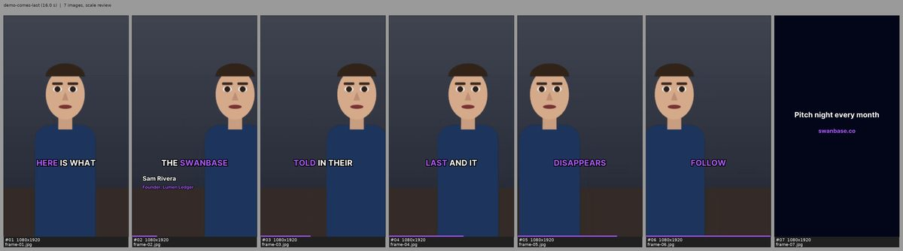

# short-video-builder

Vertical shorts from a founder's landscape video (a talk, a pitch, an interview), made on your machine: local transcription, excerpts chosen for your goal, the whole transcript proofread before anything renders, a camera that follows the face calmly, word-by-word captions, an even sound level, and the source frame rate kept. No intro card, ever: each short opens on the speaker's first words. ffmpeg, Python and OpenCV; no paid API, no upload.



## How it works

1. **Transcribe** (`words.json`): faster-whisper, whisper.cpp or openai-whisper on your machine, or your own SRT, VTT or JSON. Names from your project context prime the model.
2. **Choose** (`clips.json`): the model reads the whole transcript and picks the excerpts that stand alone for your objective (reach, leads, authority): span, the spoken hook word for word, the reason, the post copy, your brand colours and font, an optional end card.
3. **Proofread** (hard gate): every page of the transcript is read, mishearings fixed with timing kept, ambiguous words checked against evidence, then signed. The renderer refuses an unsigned or changed transcript.
4. **Check the spec**: spans snapped to word edges and inside the video, lengths, the hook really is the first thing said, copy through the writing gate.
5. **Render and measure**: 1080x1920 H.264 at the source frame rate, AAC 48 kHz at -14 LUFS; QA on every file (frame rate, first frame, first caption, loudness, face inside the crop).
6. **Review**: first-frames board, contact sheets and caption strips read against a rubric, fixes in the spec, three rounds at most, then a fresh reviewer.
7. **Deliver**: MP4s, post copy, report. You approve and publish.

## Quick start

```bash
pip install -r agents/short-video-builder/scripts/requirements.txt   # plus ffmpeg with libass
pip install faster-whisper                                            # optional, for local transcription

# The synthetic example end to end (a drawn speaker, no real footage)
cd agents/short-video-builder
python3 scripts/fixture.py /tmp/svb-demo --example
python3 scripts/transcribe.py /tmp/svb-demo/talk.mp4 --transcript /tmp/svb-demo/transcript.srt --out /tmp/svb-demo/words.json --language en
python3 scripts/proofread.py dump /tmp/svb-demo/words.json --all
python3 scripts/proofread.py apply /tmp/svb-demo/words.json /tmp/svb-demo/corrections.json
python3 scripts/proofread.py sign /tmp/svb-demo/words.json
python3 scripts/pipeline.py /tmp/svb-demo/clips.json
```

Then, from your AI coding harness:

```
Run short-video-builder for project acme on ~/videos/demo-day-pitch.mp4, 3 shorts for leads
```

The agent follows [`AGENT_SHORT_VIDEO_BUILDER.md`](AGENT_SHORT_VIDEO_BUILDER.md).

## Outputs

```
<your-projects-root>/<project>/short-video-builder/<label>-<YYYYMMDD>/
  words.json  words.raw.json  corrections.json  proofread-progress.json  proofread.json
  digest.md  clips.json  work/plan.json  work/<id>/
  export/<id>.mp4  export/<id>.json  export/qa.json
  review/first-frames.png  review/<id>/sheet.png  sheet-feed.png  captions-strip.jpg
  render-review.md  posts.md  short-video-report-<YYYYMMDD>.md
```

## What is fixed by design

- **No intro or title card.** The spec has no field for one, each clip must open on its hook, and QA fails a late first caption or a flat first frame. The optional end card comes after the last word, over the moving picture and the continuing sound.
- **Proofreading before rendering.** Recognisers mishear ordinary words, not only names; a wrong caption on screen is not shippable.
- **Source frame rate.** A 50 fps talk stays 50 fps (above 60, halved exactly). Converting to 30 drops frames unevenly and every pan judders; QA compares the output with the source.
- **Calm camera.** The crop holds still while the face moves inside a dead zone and glides slowly when it leaves it, on a sub-pixel grid.

## Tools

All external capabilities are optional: local transcription (or your transcript file), vision for the self-review (or you, with the sheets and the rubric), a fresh reviewer, the writing gate. See the Tools table of [`AGENT_SHORT_VIDEO_BUILDER.md`](AGENT_SHORT_VIDEO_BUILDER.md#tools).

## Tests

```bash
python3 agents/short-video-builder/scripts/selftest.py    # offline, about a minute on one CPU
```

Details: [`scripts/README.md`](scripts/README.md).

## Limits

- One speaker followed at a time; for two people side by side, `framing.x` picks who to follow per clip. No split screen, no multi-camera edit.
- A 720p source makes a soft short (QA warns `upscaled-source`).
- Captions keep what was said, in the spoken language: no translation, no dubbing.
- Imported cue-level subtitles give approximate karaoke timing; local transcription gives word timing.
- The agent never publishes.

## License

Apache-2.0.
