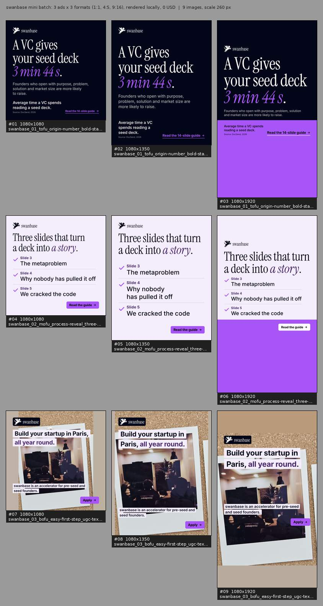

# static-ads-builder

**Finished Meta ad creatives in 1:1, 4:5 and 9:16, ready to import into Ads Manager.** It reads last month's results, plans, renders locally, proofreads every word and packages the batch. The model writes an `ads.json` spec; scripts render it in HTML/CSS to exact PNGs in 1:1, 4:5 and 9:16, with your real logo, product and photos, at no cost. The text on the ads is exactly the text in the spec, accents included, because no image model ever draws it.



## What it does

1. **Reads performance first.** Give it an Ads Manager export (level Ad, CSV) or an insights JSON: `scripts/perf.py` ranks winners, losers and inconclusive ads against a minimum spend and explicit rules, and separates a creative problem (CTR, hook rate) from a post-click problem (conversion rate, landing page views). When people still click but stop buying, it says so and asks for the page or the checkout to be fixed before more creatives.
2. **Plans a batch** that extends the winners and explores new angles, one named angle per ad, one of 18 visual styles.
3. **Renders locally.** `scripts/pipeline.py` builds the HTML from the spec and your `brand.json`, sizes every text in the browser, renders exact PNG and JPEG files, and measures each one: overflow, Meta safe zones on 9:16, WCAG contrast, minimum text size, the words actually laid out.
4. **Proofreads blind.** A reviewer that never saw the spec copies every word visible on every PNG, product labels and packaging included; `scripts/proofread.py` diffs it word by word against the spec. Any difference blocks delivery.
5. **Packages for Meta.** `scripts/package_meta.py` writes the import CSV (every ad `PAUSED`), the files per ad set, the ad copy (primary text, headline, description, CTA), the UTM links and a creative ledger, with names like `swanbase_01_tofu_origin-number_bold-statement_4x5`.

An image model never writes a word on an ad. It is only used for a text-free photographic background nobody has, and in the photo edit mode below; see [Image options](#image-options).

## Two more modes

**Photo edit (`photo_edit`).** Give it a phone photo: you holding the product, the team, a hand on the jar. The model writes 3 to 5 edit concepts for it, each at 30, 50 or 80 % of the frame (light, background, surface, crop, clutter), with what changes, what never changes (the face, the expression, the pose, the hands with five fingers, the object held) and the full prompt. `scripts/photo_edit.py` checks every concept and the consent of every person shown, then runs the edit on the [image option](#image-options) you pick. Every result is checked for size, then reviewed by a separate reviewer for the face, the hands and the object before it goes into an ad; the copy is then set over it locally, exact. The mode is optional: it only runs when you give it a photo that is weak as shot. Skill: [`skills/edit-real-photo/SKILL.md`](skills/edit-real-photo/SKILL.md).

**Winning recipe (`winning_recipe`).** From the winner of the performance read (or the ad you name), the model decomposes what it is made of: angle, hook type, text length, layout zones and hierarchy, style, palette, CTA, funnel stage. `scripts/recipe_variants.py` turns that recipe and new hooks (each claim sourced) into five ads that keep the structure and change one variable each, named `..._t-hook`, `..._t-cta`, so next month's export says which variable won. A variant that changes two things is refused. Skill: [`skills/winning-recipe/SKILL.md`](skills/winning-recipe/SKILL.md).

## What it produces

```
<your-projects-root>/<project-slug>/static-ads-builder/
├── ads-performance-YYYYMMDD.json    # the performance read, input of the next batch
├── creative-ledger.json             # every ad packaged, by name
└── <label>-YYYYMMDD/
    ├── ads.json                     # the spec
    ├── photo-edits.json             # photo edit mode: concepts per photo (edited files in media/edited/)
    ├── recipe.json, hooks.json      # winning recipe mode
    ├── renders/                     # PNG + JPEG per ad and format, qa.json, contact-sheet.jpg
    ├── proofread/                   # blind transcript and word diff
    ├── meta/                        # ads-import-YYYYMMDD.csv, exports/<ad set>/, ad-copy.md, utm.csv
    └── static-ads-YYYYMMDD.md       # the report
```

## Inputs

| Input | Default | What it does |
|-------|---------|--------------|
| project slug | inferred | names the folders and the ads |
| performance file | latest export in `static-ads-builder/exports/` | Ads Manager CSV (level Ad) or insights JSON, previous period optional |
| `target_cpa` | account median | winner and loser rules |
| `copy_language` | from project-context, else `en` | `en` or `fr` |
| `funnel_stages` | `all` | which stages the batch covers |
| `num_ads`, `formats` | 6, `4:5` + `9:16` | batch size and formats per concept |
| photos | none | your own photos, used as they are or through the photo edit mode |
| winner | first winner of the performance read | the ad the winning recipe mode builds on |

## Tools

No paid API is required. Capabilities resolve at Step 0 through [`../../shared/skills/resolving-tools/SKILL.md`](../../shared/skills/resolving-tools/SKILL.md); providers in [`../../shared/tools.md`](../../shared/tools.md).

| Capability | Used for | Without it |
|------------|----------|------------|
| `ads_insights` | last period's results (insights JSON, or the CSV export you drop) | exploration batch |
| `vision`, `critic` | visual review and blind proofread | the contact sheet and the transcript go to you |
| `image_gen` | text-free photo plates and the optional photo edit mode, see [Image options](#image-options) | real photos as they are, product, UI or pure type |
| `copy_lint` | every on-ad string and ad text | manual checklist |

### Image options

Plates (`scripts/render_ads.py --provider`) and photo edits (`scripts/photo_edit.py --backend`) run on the option you pick:

| Option | Cost and privacy |
|--------|------------------|
| `manual` (default) | free, nothing leaves your machine: the script writes a prompt pack, your agent's own image tool or your app runs it, the same command collects the files |
| `higgsfield` (photo edits) | Higgsfield credits on your account, shown before any render |
| `openai` | your OpenAI key; files go to OpenAI's API, no public link; about 0.17 USD per photo edit on `gpt-image-2`, to check |
| `fal` | your fal key; every file is uploaded to fal storage under a public URL anyone holding it can open, so attach only what you would publish |

The rules, whatever the option:

- **Consent.** A person in a photo who has not consented to ads in `project-context/people.json` blocks the render (you, marked as the operator, excepted).
- **Two spend gates.** You pick which images, then confirm model, size, count and total in one explicit yes. For openai and fal this is enforced in code: without `--confirm-spend` (or `FOG_ALLOW_SPEND=1` for a scripted run) nothing is sent, the estimate is printed and the script exits 4.
- **Public URL on fal.** A photo with people also needs `--accept-public-url`, after you and everyone shown agree.
- **Keys** stay in your environment; each is sent only to its own provider.

Local install, once:

```bash
pip install -r agents/static-ads-builder/scripts/requirements.txt
playwright install chromium
```

## Run it

### Claude Code

```
Run the static-ads-builder agent at agents/static-ads-builder/AGENT_STATIC_ADS_BUILDER.md.
Project: acme. Last month's export: acme/static-ads-builder/exports/meta-2026-09.csv. Target CPA 20 EUR.
```

### Cursor / Codex CLI / Gemini CLI

Open `agents/static-ads-builder/AGENT_STATIC_ADS_BUILDER.md` as the system prompt for a fresh session, then:

```
Follow this workflow. Project: acme. Export: acme/static-ads-builder/exports/meta-2026-09.csv.
```

### The engine alone

```bash
cd agents/static-ads-builder
python3 scripts/pipeline.py examples/swanbase-mini-batch-20261012/ads.json --out /tmp/swanbase-ads --package
python3 scripts/perf.py tests/fixtures/perf/meta-export-20261004.csv --previous tests/fixtures/perf/meta-export-20260920.csv --target-cpa 20
python3 scripts/selftest.py
python3 scripts/recipe_variants.py build tests/fixtures/recipe/recipe.json --hooks tests/fixtures/recipe/hooks.json --out /tmp/acme-variants/ads.json
```

Every script, its flags and exit codes: [`scripts/README.md`](scripts/README.md).

## Notes

- The agent reads `brand.json` from `project-context`; it does not extract a brand. Run `project-context` first for colours, fonts and logos.
- Every number on an ad comes from `positioning.proof` or a source URL listed in `ads.json`; `build.py` refuses a number without one.
- The agent never publishes. The import file sets every ad to `PAUSED`.

## License

Apache 2.0 (matches the rest of the stack).
