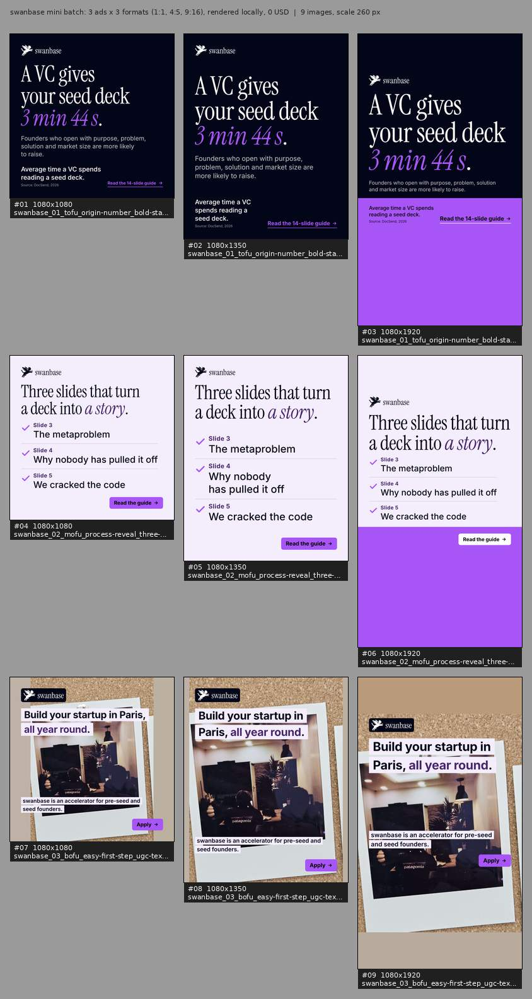

# examples/

Light, reproducible examples: the inputs and one preview image. Renders, HTML, proofread and Meta package regenerate in one command; they are not versioned (see `.gitignore`).

## `swanbase-mini-batch-20261012/`

swanbase (Paris accelerator) in English: 3 concepts x 3 formats, rendered locally, 0 USD.

| # | Stage | Angle | Style | Material |
|---|-------|-------|-------|----------|
| 1 | TOFU | origin-number | bold-statement | logo; the reading time measured by DocSend, with its source line |
| 2 | MOFU | process-reveal | three-benefits-card | logo; the three storytelling slides of the swanbase deck guide |
| 3 | BOFU | easy-first-step | ugc-text-overlay | a real swanbase polaroid, shown whole |



Files:

- `ads.json`: the spec (sources with URLs, claims for every number, Meta ad text, ad sets).
- `project-context/brand.json` and `project-context/assets/logos/`: the brand as `project-context` writes it.
- `media/screening-room-polaroid.jpg`: the photo of ad 3. Its `visible_text` declares the third-party wordmark printed on a sweatshirt; the ad's `notes` flag it for the founder's decision before spend.
- `transcript.json`: the blind proofread of the 9 renders, written by a fresh sub-agent that only saw the PNGs. `proofread.py check` gives 9/9 `TEXT_OK`.
- `preview.jpg`: the contact sheet (rows: ads, columns: 1:1, 4:5, 9:16).

Regenerate everything:

```bash
python3 scripts/pipeline.py examples/swanbase-mini-batch-20261012/ads.json \
  --transcript examples/swanbase-mini-batch-20261012/transcript.json --package
```

The 18 styles in the three formats, on a fictional brand: `tests/fixtures/all-styles/ads.json`.
